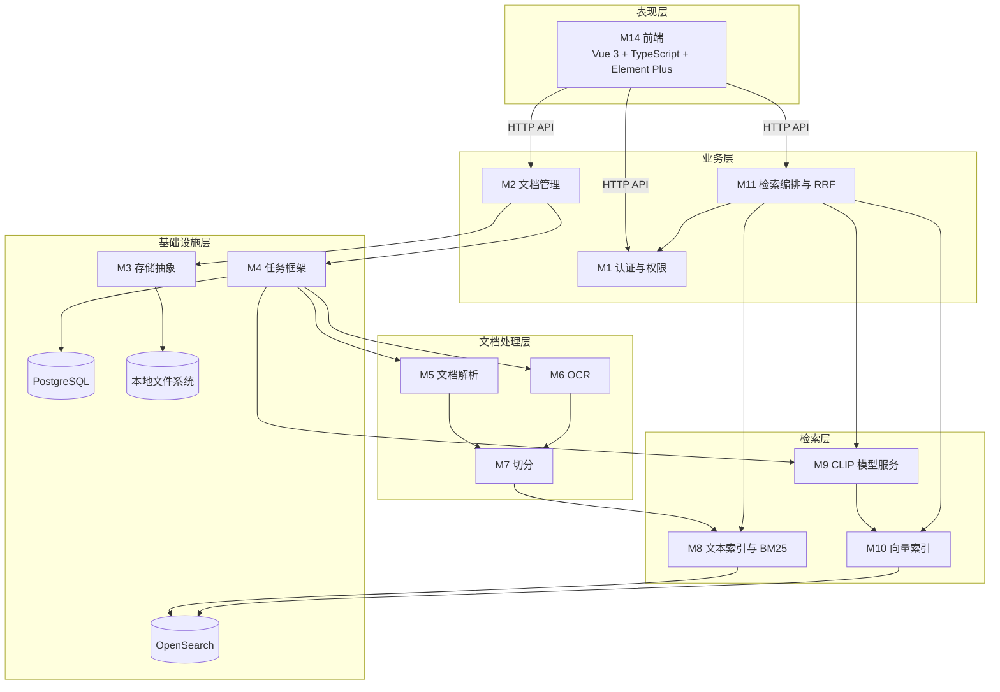
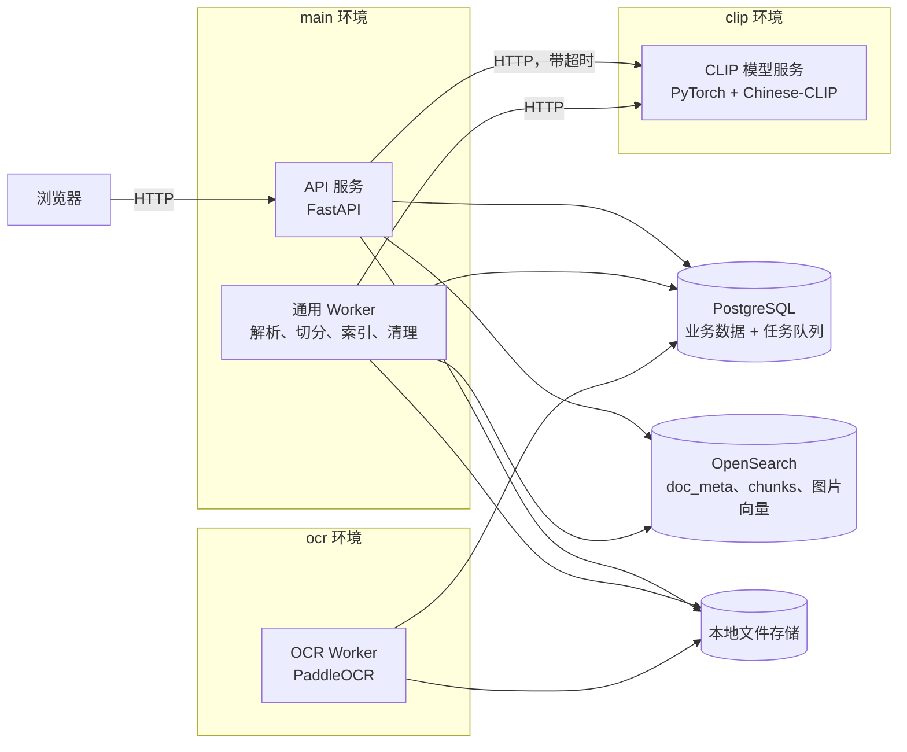
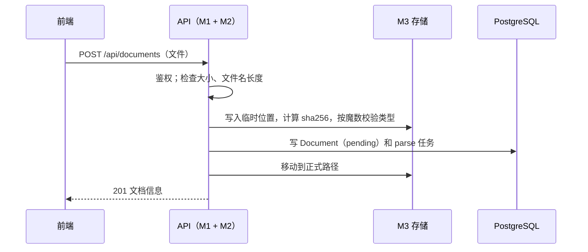
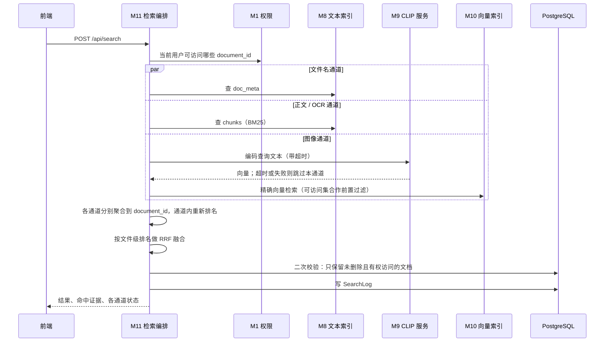

# 系统架构（T04）

本文档描述系统的分层、模块、进程和数据流，内容来自 GLOBAL §3.2–§3.4，并补充了代码位置和实现进度。
设计决策的理由见 `decisions.md`，接口见 `api.md`，表结构见 `data-model.md`。

## 1. 系统定位

单机部署的智能文档管理系统：用户上传 Word、PDF、Excel 和图片，系统在后台解析、OCR、建立索引，
之后可以按文件名、正文、OCR 文字和图片的视觉内容检索，并能把结果定位回原始文件的页、段落、单元格范围或图片。

三条贯穿全系统的原则：

1. **基础功能不依赖 AI 组件。** OCR 和图文模型各自运行在独立进程里，任何一个不可用，文件管理和文本检索照常工作。
2. **文件是统一单位。** 融合、评测、权限判断都以 `document_id` 为单位；片段和图片只是命中证据。
3. **数据库是唯一的事实来源。** 搜索索引可以丢失、可以重建；删除和权限以数据库为准，检索返回前必须回数据库校验。

## 2. 逻辑分层



图外还有两个只读使用者：M12 实验评测（只调用 M11）和 M13 一致性检查（对账数据库、磁盘、索引）。

## 3. 模块表

“独立测试”一列为“是”的模块必须能脱离 Web 系统单独测试（GLOBAL §3.2）。

| 编号 | 模块 | 接口（输入 → 输出） | 代码位置 | 独立测试 | 任务 | 状态 |
|---|---|---|---|---|---|---|
| — | 数据契约与 ID | 模块间唯一的数据交换格式 | `shared/contracts`、`shared/ids.py` | 是 | T02 | 已完成 |
| — | 数据库模型与迁移 | 表结构 | `backend/app/db` | — | T03 | 已完成 |
| — | 配置与健康检查 | 环境变量 → 配置；`GET /health` | `backend/app/config.py`、`api/health.py` | — | T01 | 已完成 |
| M1 | 认证与权限 | user → 可访问的 document_id 集合；`can_access(user, doc)` | `backend/app/modules/auth` | — | T06 | 已完成（数据库集成测试未测试） |
| M2 | 文档管理 | API 请求 → Document 记录；软删除；创建任务 | `backend/app/modules/documents` | — | T08 | 已完成（数据库集成测试未测试） |
| M3 | 存储抽象 | 字节流 → `storage_key`；按 key 读取、删除 | `backend/app/modules/storage` | 是 | T05 | 已完成 |
| M4 | 任务框架 | 任务 → 状态流转（领取、租约、重试、幂等） | `shared/tasks.py`、`backend/app/worker` | — | T07、T14 | 已完成（数据库集成测试未测试）；T14 登记了 parse、cleanup 两个处理函数 |
| M5 | 文档解析 | 文件路径 → `ParsedDocument`（纯函数） | `backend/app/modules/parsing` | 是 | T09、T11 | 已完成：PDF（T09），Word、Excel、图片（T11）；已接入 Worker 的 parse 任务（T14） |
| M6 | OCR | 图片 → `OCRResult` | `services/ocr_worker` | 是 | T17 | 未开始 |
| M7 | 切分 | `ParsedDocument` → `Chunk[]`（纯函数） | `backend/app/modules/chunking` | 是 | T12 | 已完成（T12）；已接入 Worker 的 parse 任务（T14） |
| M8 | 文本索引与 BM25 | `Chunk[]` / 查询 → 排序列表 | `backend/app/modules/text_index` | — | T13、T15 | 索引的创建、写入、删除已完成（T13），由 parse、cleanup 任务和改标签接口调用（T14），都未在真实 OpenSearch 上运行；BM25 查询在 M11 里实现（T15） |
| M9 | CLIP 模型服务 | 图片 / 文本 → 向量 | `services/clip_service` | 是 | T20 | 未开始 |
| M10 | 向量索引 | 向量 → 排序列表 | `backend/app/modules/vector_index` | — | T21 | 未开始 |
| M11 | 检索编排与 RRF | 查询 → `SearchHit[]` | `backend/app/modules/search` | — | T15、T22 | v1 已完成（T15）：meta、text 两路、RRF、数据库二次校验、检索日志；图像通道待 T22（`decisions.md` D28） |
| M12 | 实验评测 | 实验配置 → 指标 + 原始结果 | `experiments/` | — | T19 | 未开始 |
| M13 | 一致性检查 | — → 数据库 / 磁盘 / 索引的差异报告 | `backend/app/modules/consistency` | — | T18 | 未开始 |
| M14 | 前端 | 只依赖 API 契约 | `frontend/` | — | T10、T16、T23 | 骨架已完成（T10）；检索页、预览页（PDF 用 pdf.js、图片、Word/Excel 抽取文本）已完成（T16，`decisions.md` D29），只对着模拟接口检查过；图片与通道标记（T23）未开始 |

M2 和 M11 是耦合中心：M2 串起存储、任务和权限，M11 汇聚所有检索通道。这两个模块的接口先定稳再实现。

## 4. 进程与运行环境

PaddlePaddle 和 PyTorch 不能装进同一个 Python 环境，所以系统分成四个进程、三套虚拟环境（附录 A4）。



| 进程 | 虚拟环境 | 职责 | 挂掉时的影响 |
|---|---|---|---|
| API 服务 | main | HTTP 接口、鉴权、检索编排 | 系统不可用 |
| 通用 Worker | main | 解析、切分、BM25 索引、清理任务 | 新上传的文件停留在“等待处理”，已有文件照常检索 |
| OCR Worker | ocr | 只处理 OCR 任务 | 扫描件和图片暂时没有 OCR 文字，其余不受影响 |
| CLIP 模型服务 | clip | 常驻加载模型，编码图片和查询文本 | 图像通道降级，检索结果只来自文本通道，并在响应中标记 |

三个环境通过 `shared/` 包共用数据契约、ID 规则和任务领取逻辑，`shared/` 只依赖 pydantic 和 psycopg。
进程之间不直接调用，只有两种协作方式：经由 PostgreSQL 任务表传递任务，或经 HTTP 调用 CLIP 模型服务。

## 5. 数据流

### 5.1 写入：上传一个文件



任何一步失败都清理已产生的部分，不留下半成品（GLOBAL §6）。解析不在上传请求中执行。

### 5.2 处理：后台任务

```
Worker 领取任务（SELECT … FOR UPDATE SKIP LOCKED，写入租约）
  └─ M5 解析 ─┬─ 有文本层的内容 ───────────→ M7 切分 → 写 DocumentChunk → M8 写 chunks 索引（source_type=body）
              ├─ 扫描页 / 图片 → 创建 ocr 任务 → OCR Worker：M6 识别 → M7 切分 → M8 写 chunks 索引（source_type=ocr）
              └─ 图片 ────────→ 创建 embed 任务 → M9 编码 → 写 ImageEmbedding → M10 写向量索引
  └─ 回写任务和文档状态：succeeded，或 failed + 失败原因
```

T14 的实现（`decisions.md` D27）：parse 任务先写 `doc_meta`，再解析、切分、写 DocumentChunk、写 `chunks` 索引，最后把文档标为 succeeded 并按页（或整张图片）创建 ocr 任务；embed 任务尚未创建（T21）。文档状态只跟随 parse 任务。

任务框架保证的四件事（GLOBAL §3.3，附录 A3）：

| 机制 | 作用 |
|---|---|
| 租约与回收 | Worker 处理中定期续约；崩溃后租约过期，任务回到等待队列，不会永远卡住 |
| 重试上限 | 超过最大重试次数标记为 `failed` 并保存原因 |
| 幂等 | 片段 ID 是确定性的，同一任务执行两次只会覆盖，不会产生重复数据 |
| 子进程隔离 | 每个文件在子进程里解析，有超时和内存上限，一个坏文件不会拖垮 Worker |

### 5.3 查询：一次检索



顺序是固定的：先在通道内聚合到文件，再融合，最后回数据库校验（GLOBAL §4.4、§4.5）。
同一张图片既被 OCR 文字命中又被 CLIP 命中时，因为 `document_id` 相同而自然合并。

### 5.4 删除

```
DELETE /api/documents/{id}
  → M2 写 deleted_at（软删除，立即对所有查询不可见）
  → M4 创建清理任务
      → M8、M10 删除索引 → M3 删除文件 → 硬删除数据库记录（相关行级联删除）
```

软删除到清理完成之间，索引里仍有这个文档的数据；这段时间靠 5.3 的数据库二次校验保证它不会出现在结果里。

## 6. 检索索引结构

| 索引 | 粒度 | 主要字段 | 用途 |
|---|---|---|---|
| `doc_meta` | 文件，`_id` 为 `document_id` | `document_id`、`filename`、`tags`（后两者为全文字段，另有 `.raw` 精确值子字段） | 文件名 / 标签检索（实验 B0） |
| `chunks` | 片段，`_id` 为 `chunk_id` | 与 `Chunk` 契约一致：`chunk_id`、`document_id`、`parse_version`、`seq`、`source_type`、`text`、`locator`（只存储、不索引） | 正文与 OCR 文字的 BM25（实验 B1、B2） |
| 图片向量索引 | 图片 | 向量、`document_id` | CLIP 图像检索（实验 B3） |

- 文件名不写进 `chunks`，避免一个文件的每个片段都给文件名加一次分（附录 A8）。
- B1 与 B2 的区别只是 `source_type` 的过滤条件，不维护两套索引。
- 向量检索用精确计算，不用近似索引（附录 A12）。
- 中文分词用 analysis-smartcn（附录 A13，Barry 于 2026-11-14 选定，未经实测）。mapping 文件在 `backend/app/modules/text_index/mappings/`，纳入版本管理；两个索引都是 strict mapping，不含权限字段（附录 A10），结构说明见 `decisions.md` D26。

## 7. 故障与降级

| 故障 | 处理方式 |
|---|---|
| CLIP 服务不可用或超时 | 本次查询跳过图像通道，响应中标记该通道不可用，文本检索结果照常返回 |
| OCR 失败 | 任务标记失败并保存原因，原文件保留，可重试 |
| 单个文件解析失败、超时或内存超限 | 终止子进程，任务标记失败，不影响其他文件 |
| OpenSearch 不可用 | 检索接口返回明确的“检索服务不可用”错误，不返回空结果 |
| Worker 中断 | 租约过期后任务自动回收 |
| 数据库、磁盘、索引不一致 | 一致性检查脚本报告差异并提供重建入口；检索时的数据库校验兜底 |

原则：不把错误悄悄变成空结果，用户必须能区分“没有搜到”和“检索服务出了故障”（GLOBAL §12）。

## 8. 目录结构

见 DEVPLAN §2。目录与本文档的对应关系：`shared/` 是三个环境共用的契约层，`backend/` 是 main 环境的
API 和通用 Worker，`services/` 下是两个独立环境的 AI 进程，`experiments/` 是 M12，`frontend/` 是 M14，
`deploy/` 是依赖服务的编排文件。
