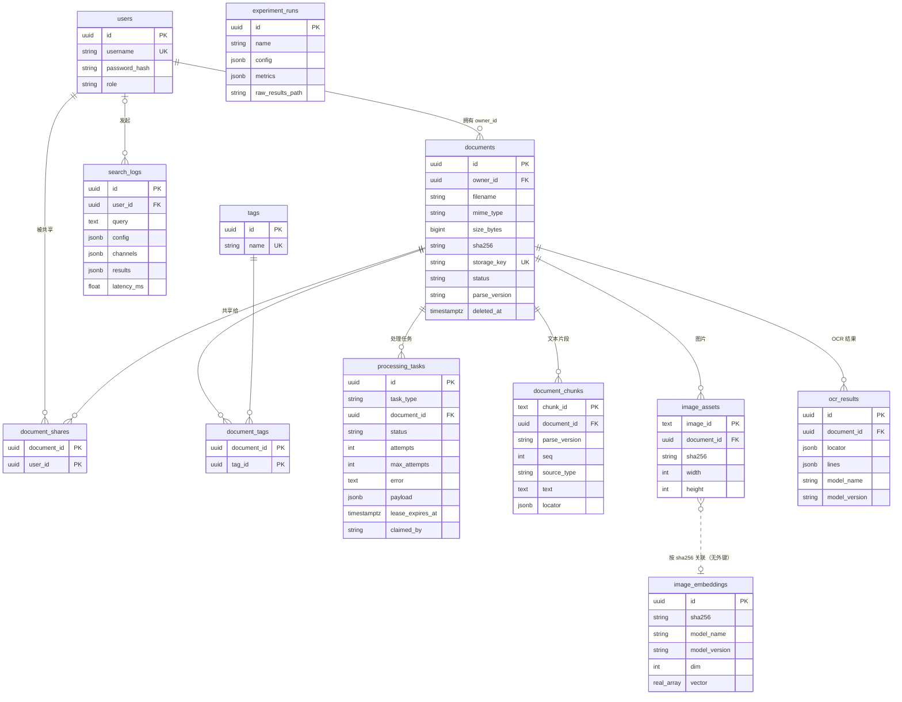

# 数据模型（T03）

对应 GLOBAL §6。表结构的唯一来源是 `backend/app/db/models.py`，迁移脚本在
`backend/app/db/migrations/versions/`。本文档与二者不一致时，以代码为准并修正本文档。

## 1. ER 图

## 2. 通用约定

| 约定 | 说明 |
|---|---|
| 主键 | 默认是 UUID，由应用生成。`document_chunks`、`image_assets` 用确定性的文本 ID（见 `shared/ids.py`），重复写入时直接覆盖。 |
| 枚举 | 用 字符串 + CHECK 约束，不用 PostgreSQL 的 ENUM 类型，以后增减取值只需改约束。 |
| 时间 | 全部是带时区的 `timestamptz`；`created_at` 由数据库填 `now()`。 |
| 删除 | 子表对 `documents` 的外键都是 `ON DELETE CASCADE`。日常删除是软删除（写 `deleted_at`）；硬删除只发生在清理任务的最后一步，届时相关行一并删除。 |
| 约束命名 | 统一规则（`pk_表`、`fk_表_列_目标表`、`uq_表_列`、`ck_表_名称`、`ix_表_列`），迁移降级时按名字删除。 |

## 3. 字段说明

### users —— 用户

| 字段 | 类型 | 说明 |
|---|---|---|
| id | uuid，主键 | |
| username | varchar(64)，唯一 | 登录名 |
| password_hash | varchar(255) | 密码哈希，不存明文（GLOBAL §7.2） |
| role | varchar(16)，默认 `user` | 只能是 `user` 或 `admin` |
| created_at | timestamptz | |

### documents —— 文档（融合、评测、权限的统一单位）

| 字段 | 类型 | 说明 |
|---|---|---|
| id | uuid，主键 | 即 `document_id` |
| owner_id | uuid，外键 → users，有索引 | 上传者。不级联：有文档的用户不能被直接删除 |
| filename | varchar(255) | 用户上传时的原始文件名，只用于展示和检索，不参与存储路径 |
| mime_type | varchar(127) | 按文件魔数识别的真实类型 |
| size_bytes | bigint，≥ 0 | |
| sha256 | varchar(64)，有索引 | 文件内容哈希 |
| storage_key | varchar(512)，唯一 | 存储抽象层的键，形如 `{yyyy}/{document_id}/{sha256}.{ext}` |
| status | varchar(16)，默认 `pending` | 处理状态：`pending` / `processing` / `succeeded` / `failed`。只跟随 parse 任务：开始处理为 `processing`，成功为 `succeeded`，parse 任务最终失败为 `failed`，重试失败的 parse 任务时回到 `pending`；OCR、清理任务不改它（`decisions.md` D27） |
| parse_version | varchar(64)，可空 | 当前生效的解析版本；未解析成功时为空 |
| created_at / updated_at | timestamptz | |
| deleted_at | timestamptz，可空，有索引 | 软删除标记，非空即对所有查询不可见（GLOBAL §4.5） |

### document_shares —— 文档共享

| 字段 | 类型 | 说明 |
|---|---|---|
| document_id | uuid，联合主键，外键 → documents（级联） | |
| user_id | uuid，联合主键，外键 → users（级联），有索引 | 被共享者，获得只读和检索权限 |
| created_at | timestamptz | |

联合主键保证同一文档对同一用户只有一条共享记录；取消共享即删除该行。

### tags / document_tags —— 标签

| 表 | 字段 | 说明 |
|---|---|---|
| tags | id（uuid 主键）、name（varchar(64)，唯一） | 标签名全局唯一 |
| document_tags | document_id + tag_id（联合主键，均级联） | 文档与标签的多对多关联，支撑 B0 的标签检索 |

### processing_tasks —— 处理任务（同时是任务队列）

| 字段 | 类型 | 说明 |
|---|---|---|
| id | uuid，主键 | |
| task_type | varchar(32) | 任务类型（parse、ocr、embed、cleanup 等，由 T07 及后续任务定义） |
| document_id | uuid，外键 → documents（级联），有索引 | |
| status | varchar(16)，默认 `pending` | `pending` / `processing` / `succeeded` / `failed` |
| attempts | int，默认 0 | 已尝试次数 |
| max_attempts | int，默认 3，≥ 1 | 最大重试次数 |
| error | text，可空 | 失败原因 |
| payload | jsonb，默认 `{}` | 任务参数，例如 OCR 任务要处理的页码 |
| created_at | timestamptz | |
| started_at / finished_at | timestamptz，可空 | 开始、完成时间 |
| lease_expires_at | timestamptz，可空 | 租约到期时间；过期仍为 `processing` 说明 Worker 已崩溃，可回收 |
| claimed_by | varchar(128)，可空 | 领取者标识 |

索引 `ix_processing_tasks_claim (status, task_type, created_at)` 服务于领取查询。

### document_chunks —— 文本片段

| 字段 | 类型 | 说明 |
|---|---|---|
| chunk_id | text，主键 | `{document_id}:{parse_version}:{seq}` |
| document_id | uuid，外键 → documents（级联） | |
| parse_version | varchar(64) | |
| seq | int | 片段序号 |
| source_type | varchar(8) | `body`（文档文本层）或 `ocr`（OCR 文字） |
| text | text | 片段正文。存数据库是为了 Word/Excel 预览，以及索引丢失时重建 |
| locator | jsonb | 来源定位，结构见 `shared.contracts.SourceLocator` |
| created_at | timestamptz | |

`(document_id, parse_version, seq)` 唯一。

### image_assets —— 图片资源

| 字段 | 类型 | 说明 |
|---|---|---|
| image_id | text，主键 | 独立图片等于 `document_id`；内嵌图片（P4）为 `{document_id}:img:{page}:{idx}` |
| document_id | uuid，外键 → documents（级联），有索引 | 图片所属文档（结构关联） |
| sha256 | varchar(64)，有索引 | 图片内容哈希，用来找到对应的向量 |
| width / height | int，可空 | 像素尺寸 |
| created_at | timestamptz | |

### ocr_results —— OCR 结果

| 字段 | 类型 | 说明 |
|---|---|---|
| id | uuid，主键 | |
| document_id | uuid，外键 → documents（级联），有索引 | |
| locator | jsonb | 被识别的对象：PDF 的某一页或一张图片 |
| lines | jsonb | 每行的文字、四点 bbox、置信度（`shared.contracts.OCRLine`） |
| model_name / model_version | varchar | OCR 模型名称和版本 |
| created_at | timestamptz | |

### image_embeddings —— 图片向量

| 字段 | 类型 | 说明 |
|---|---|---|
| id | uuid，主键 | |
| sha256 | varchar(64) | 图片内容哈希 |
| model_name / model_version | varchar | 生成向量的模型 |
| dim | int，≥ 1 | 向量维度 |
| vector | real[] | 向量本体。存数据库是为了向量索引丢失时直接重建，不必重新跑 CLIP |
| created_at | timestamptz | 生成时间 |

`(sha256, model_name, model_version)` 唯一：相同内容的图片在同一模型下只编码一次。
这张表不挂 `document_id`，多个文档可以共用一条向量；`image_assets.sha256` 与它是逻辑关联，没有外键。

### search_logs —— 检索日志（必选）

| 字段 | 类型 | 说明 |
|---|---|---|
| id | uuid，主键 | |
| user_id | uuid，可空，外键 → users（删除用户时置空），有索引 | |
| query | text | 查询文本 |
| config | jsonb | 本次检索生效的参数：`{top_k, channels, source_types, params}`，`channels` 为生效的通道开关，`params` 为 RRF k、截断深度、字段权重等全部检索配置 |
| channels | jsonb | 各通道的执行情况：`{通道名: {status, took_ms, detail, hits}}`，`status` 为 `ok` / `disabled` / `unavailable` |
| results | jsonb | 返回给用户的最终结果（二次校验、截取之后）：`[{document_id, score, channels, evidence_chunk_id}]`，`channels` 为该文档在各通道的原始名次和分数 |
| latency_ms | double | 总耗时 |
| created_at | timestamptz，有索引 | |

每次检索写一条（T15，`decisions.md` D28），检索服务故障时也写；请求校验失败（422）不写。

### experiment_runs —— 实验记录（必选）

| 字段 | 类型 | 说明 |
|---|---|---|
| id | uuid，主键 | |
| name | varchar(128) | 实验名，如 B0、B1 |
| config | jsonb | 完整实验配置 |
| metrics | jsonb，可空 | 运行结束后写入的汇总指标 |
| raw_results_path | varchar(512)，可空 | 每条查询原始排名的文件路径 |
| started_at / finished_at | timestamptz | |

## 4. 迁移

在 `backend/` 目录、main 环境下执行；数据库地址取自 `DATABASE_URL`。

| 操作 | 命令 |
|---|---|
| 升级到最新 | `alembic upgrade head` |
| 回退一个版本 | `alembic downgrade -1` |
| 查看当前版本 | `alembic current` |
| 改了 `models.py` 后生成迁移 | `alembic revision --autogenerate -m "说明"`，生成后必须人工检查 |

`downgrade` 会删除表和其中的数据，只能在开发库或测试库上执行。
